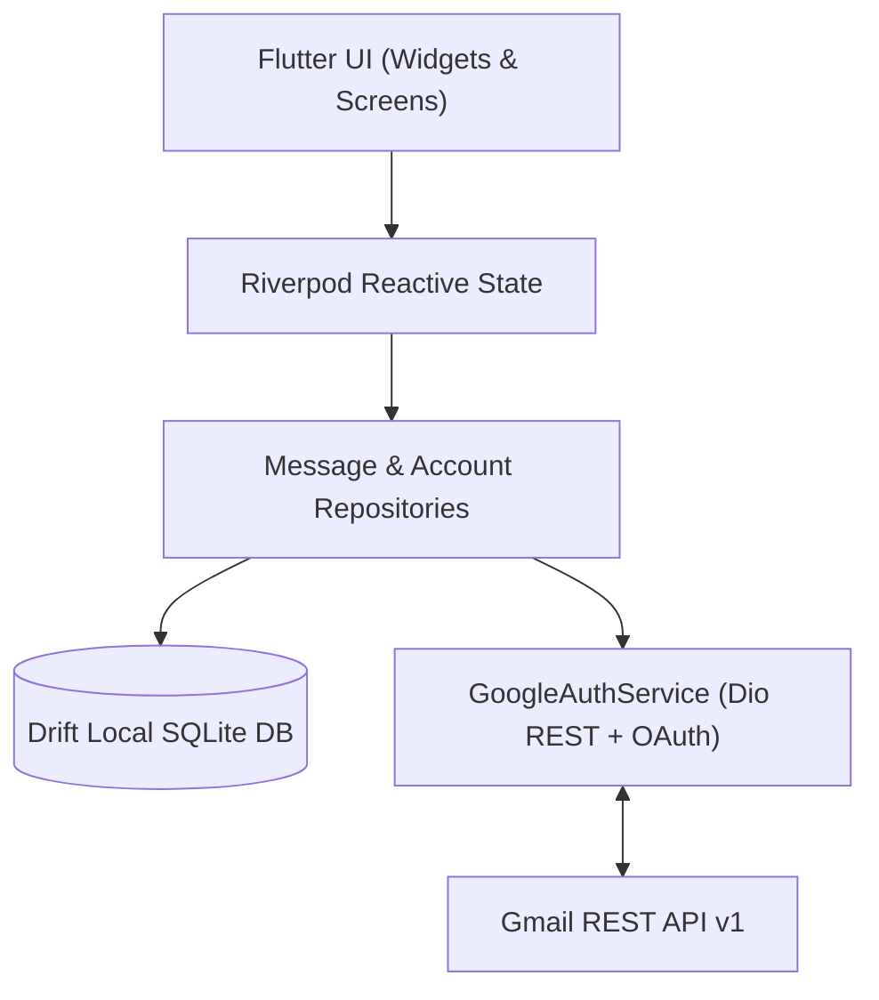
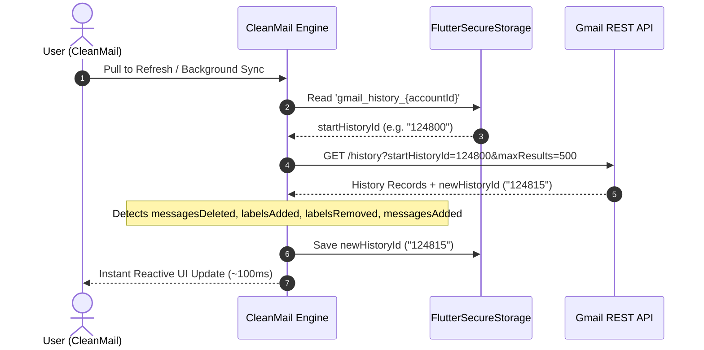
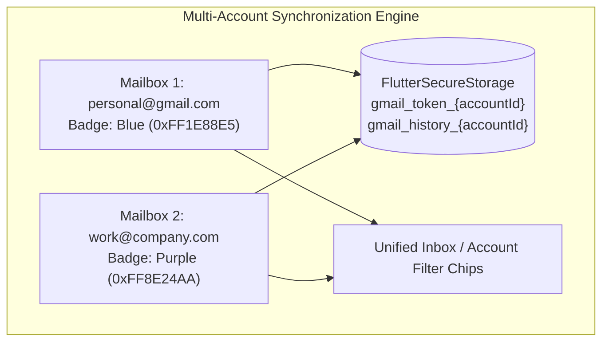

# CleanMail Technical & Synchronization Architecture 📐⚡

This document details the internal technical design, synchronization algorithms, and cloud integration protocols implemented in **CleanMail**.

---

## 📑 Table of Contents
1. [Architectural Overview](#1-architectural-overview)
2. [Approach 2: Gmail Delta History Sync (`users.history.list`)](#2-approach-2-gmail-delta-history-sync-usershistorylist)
3. [Full Two-Way Symmetrical Synchronization Matrix](#3-full-two-way-symmetrical-synchronization-matrix)
4. [Android OAuth & Google Play Services Architecture](#4-android-oauth--google-play-services-architecture)
5. [Local Database & Offline Engine](#5-local-database--offline-engine)
6. [Data Pipeline: HTML Stripping & Pixel Elimination](#6-data-pipeline-html-stripping--pixel-elimination)
7. [Multi-Mailbox Architecture & Per-Account OAuth Isolation](#7-multi-mailbox-architecture--per-account-oauth-isolation)

---

## 1. Architectural Overview

CleanMail follows a clean, reactive, offline-first architecture separating business logic, persistence, and network layers:



* **UI Layer**: Pure Dart Flutter widgets operating entirely on text and metadata; zero WebViews.
* **State Management**: Riverpod streams reacting automatically to SQLite row mutations.
* **Storage Layer**: Drift (SQLite) using native SQLite on Android/Windows and WASM + WebWorker on Web.
* **Cloud Sync Layer**: Google Identity Services (Web) & Google Play Services (Android) communicating directly with Google's Gmail API endpoints.

---

## 2. Approach 2: Gmail Delta History Sync (`users.history.list`)

### The Problem with Traditional Mail Sync
Traditional email clients either fetch entire mailboxes repeatedly or maintain heavy background IMAP IDLE connections. For users with large mailboxes (**10,000 to 500,000+ emails**), fetching message lists consumes excessive network bandwidth, drains battery, and rapidly exhausts Gmail API daily quotas (free tier: 250 units/sec, 1,000,000 units/day).

### The Solution: Checkpoint-Based Delta Sync
CleanMail implements **Gmail Delta History Synchronization** via `GET /gmail/v1/users/me/history`:



### Key Performance Characteristics
* **Network Latency**: $\approx \mathbf{100-200ms}$ per sync cycle.
* **Quota Footprint**: Only **2 quota units** per sync check when no new messages exist.
* **Scale-Free**: Operates identically whether the mailbox has 100 emails or 500,000 emails.
* **Self-Healing Fallback (HTTP 404 Recovery)**:
  * Google expires a `historyId` if the mailbox has not synced in over 30 days.
  * When a `DioException (404)` is caught, CleanMail automatically falls back to an initial windowed sync (`_syncRecentGmailMessages`), queries `users.getProfile` for a fresh `historyId`, and resets the checkpoint seamlessly.

---

## 3. Full Two-Way Symmetrical Synchronization Matrix

CleanMail maintains full bi-directional consistency across all user actions:

| Action | Direction: CleanMail $\rightarrow$ Gmail | Direction: Gmail $\rightarrow$ CleanMail |
| :--- | :--- | :--- |
| **Mark as Read** | Issues `POST /messages/{id}/modify`<br>`{ "removeLabelIds": ["UNREAD"] }` | Delta history detects `labelsRemoved: ['UNREAD']`<br>$\rightarrow$ marks read in local SQLite. |
| **Mark as Unread** | Issues `POST /messages/{id}/modify`<br>`{ "addLabelIds": ["UNREAD"] }` | Delta history detects `labelsAdded: ['UNREAD']`<br>$\rightarrow$ marks unread in local SQLite. |
| **Archive** | Issues `POST /messages/{id}/modify`<br>`{ "removeLabelIds": ["INBOX"] }` | Delta history detects `labelsRemoved: ['INBOX']`<br>$\rightarrow$ marks archived in local SQLite. |
| **Delete** | Issues `POST /messages/{id}/trash`<br>Moves message to Gmail Trash | Delta history detects `messagesDeleted` or `labelsAdded: ['TRASH']`<br>$\rightarrow$ deletes locally. |
| **Restore (Undo)** | Issues `POST /messages/{id}/untrash`<br>Restores message from Trash | Message restored to local SQLite database and re-indexed. |
| **Sender Sweep** | Batch-trashes all remote IDs concurrently in chunks of 5 via `POST /trash` | All sender messages purged locally and moved to Trash in real Gmail. |

### API Endpoint Mapping
* **Trash**: `POST https://gmail.googleapis.com/gmail/v1/users/me/messages/{id}/trash`
* **Untrash**: `POST https://gmail.googleapis.com/gmail/v1/users/me/messages/{id}/untrash`
* **Label Modification**: `POST https://gmail.googleapis.com/gmail/v1/users/me/messages/{id}/modify`
* **History Delta**: `GET https://gmail.googleapis.com/gmail/v1/users/me/history?startHistoryId={id}`
* **Profile Checkpoint**: `GET https://gmail.googleapis.com/gmail/v1/users/me/profile`

---

## 4. Android OAuth & Google Play Services Architecture

### Android vs. Web OAuth Resolution
A common issue in cross-platform Flutter email clients is `PlatformException (sign_in_failed)` on Android. This occurs because Google's authentication mechanisms differ by platform:

1. **Web (Google Identity Services / GSI)**:
   * Requires an explicit Web OAuth Client ID (`clientId: ...apps.googleusercontent.com`).
   * Authorized JavaScript Origins must match `http://localhost:<port>` or production URL.
2. **Android (Google Play Services)**:
   * Uses package signature authentication via the device's Google Play Services daemon.
   * Passing `clientId` explicitly on Android triggers `PlatformException(sign_in_failed, 10)` because Play Services requires looking up credentials via `(Package Name, Keystore SHA-1)`.
   * **CleanMail Solution**:
     ```dart
     GoogleSignIn(
       clientId: kIsWeb ? effectiveClientId : null,
       serverClientId: !kIsWeb ? effectiveClientId : null,
       scopes: ['email', ...gmailScopes],
     );
     ```

### Android Manifest & Gradle Setup
* **Package Name**: `com.shuvankar.cleanmail`
* **Debug Keystore SHA-1**: `09:C2:9D:D4:63:78:55:CB:81:E8:FC:34:84:88:C3:8C:BA:09:52:D2`
* **Required Android Permissions**:
  ```xml
  <uses-permission android:name="android.intent.permission.INTERNET"/>
  ```

---

## 5. Local Database & Offline Engine

CleanMail uses **Drift (Fluent SQLite ORM)** with two primary tables:
* `AccountsTable`: Connected mailboxes (Gmail, Outlook, Demo).
* `MessagesTable`: Indexed, classified, plain-text emails.

### Schema Indexes
To ensure sub-millisecond queries across thousands of cached emails, the following composite indexes are maintained:
* `idx_messages_inbox`: `(is_archived, received_at DESC)`
* `idx_messages_account`: `(account_id, is_archived, received_at DESC)`
* `idx_messages_category`: `(category, is_archived, received_at DESC)`
* `idx_messages_remote`: `(account_id, remote_message_id)`
* `idx_messages_sender`: `(sender_email, is_archived)`

### Aggregations & Sender Sweep Query
Sender Sweep groups emails by sender volume with instant unread calculations:
```sql
SELECT 
  sender_email,
  sender_name,
  account_id,
  COUNT(*) AS total_count,
  SUM(CASE WHEN is_read = 0 THEN 1 ELSE 0 END) AS unread_count,
  MAX(received_at) AS last_received_at,
  (
    SELECT subject FROM messages_table m2 
    WHERE m2.sender_email = messages_table.sender_email 
    ORDER BY m2.received_at DESC LIMIT 1
  ) AS latest_subject
FROM messages_table
WHERE is_archived = 0
GROUP BY sender_email
ORDER BY total_count DESC;
```

### Deduplication & Idempotent Import Engine
To eliminate duplicate email entries across syncs, CleanMail implements a 3-layer deduplication defense:

1. **Deterministic Primary Key Generation**:
   * Instead of assigning random UUIDs on each fetch, message IDs are strictly derived:
     $$\text{id} = \text{accountId} + \text{"\_"} + \text{remoteMessageId}$$
   * When Drift's `insertAllOnConflictUpdate` runs, re-fetched messages update the existing record rather than creating a duplicate row.

2. **Pre-Fetch Deduplication Filtering**:
   * Prior to issuing expensive `/messages/{id}?format=full` detail queries, CleanMail queries `getExistingRemoteMessageIds(accountId)` from SQLite.
   * Already-imported messages are skipped, conserving 100% of network data and Gmail API quota units.

3. **Self-Healing Legacy Deduplication**:
   * On every sync cycle, CleanMail executes an automatic deduplication cleanup query:
     ```sql
     DELETE FROM messages_table
     WHERE id NOT IN (
       SELECT MIN(id)
       FROM messages_table
       GROUP BY account_id, remote_message_id
     );
     ```
   * Any historical duplicate records created before deterministic IDs are automatically cleaned up.

---

## 6. Data Pipeline: HTML Stripping & Pixel Elimination

Before any email is stored or shown to the user, it passes through the sanitization pipeline in `HtmlToTextConverter`:

1. **DOM Parsing**: Parses raw HTML parts (or decoded `base64url` body payloads) via package `html`.
2. **Tag Removal**: Completely strips `<script>`, `<style>`, `<noscript>`, `<svg>`, `<canvas>`, and `<template>`.
3. **Tracking Pixel Removal**:
   * Scans all `` tags.
   * Matches `1x1` dimensions (explicit `width="1"` / `height="1"`, or inline CSS `width: 1px`).
   * Matches common tracking pixel domains or zero-dimension images and strips them entirely.
4. **Structural Conversion**:
   * Converts `<p>` and `<br>` into standard paragraph line breaks.
   * Formats lists (`<ul>`, `<ol>`, `<li>`) with bullet points (`• `).
   * Transforms `<a>` links into clean markdown links `[text](url)` or plain footnotes without deceptive styling.
5. **Entity Decoding**: Decodes HTML character entities (`&nbsp;`, `&amp;`, `&quot;`, `&#39;`).
6. **Whitespace Normalization**: Compresses multi-blank lines into standard readable spacing.

---

## 7. Multi-Mailbox Architecture & Per-Account OAuth Isolation

CleanMail enables users to connect and manage multiple independent Gmail mailboxes simultaneously (e.g. personal, work, client accounts).



### Key Multi-Account Pillars:

1. **Account Chooser Prompt Guarantee**:
   * Calling `await _googleSignInInstance.signOut()` before `signIn()` clears any in-memory cached session. This forces Google Play Services (Android) and Google Identity Services (Web) to present the system **Account Chooser** dialog ("Choose an account" / "Add another account") every time "Connect Gmail Account" is tapped, rather than auto-signing back into the previous mailbox.

2. **Per-Account OAuth Token Storage**:
   * Each connected mailbox stores its OAuth access token in `FlutterSecureStorage` under `gmail_token_{accountId}`.
   * All outbound API operations (`trashGmailMessage`, `untrashGmailMessage`, `batchTrashGmailMessages`, `modifyGmailMessageLabels`, `markGmailMessageRead`, `archiveGmailMessage`) resolve tokens per `accountId`.
   * When modifying an email belonging to Account 1 while Account 2 was the last added session, CleanMail retrieves the correct credentials for Account 1.

3. **Per-Account Delta History Checkpoints**:
   * Each account maintains its own independent `startHistoryId` checkpoint (`gmail_history_{accountId}`).
   * When pull-to-refresh or background sync runs across all mailboxes, each mailbox queries its own delta history in parallel without cross-account state collisions.

4. **Multi-Mailbox Single Pane Switcher & Distinct Badge Colors**:
   * Connected mailboxes are assigned rotating palette colors (`AppConstants.accountBadgeColors`: Blue, Purple, Teal, Deep Orange, Green, Indigo).
   * The Inbox header renders single-tap filter chips allowing users to seamlessly switch between "All Inboxes" and specific mailbox views.
